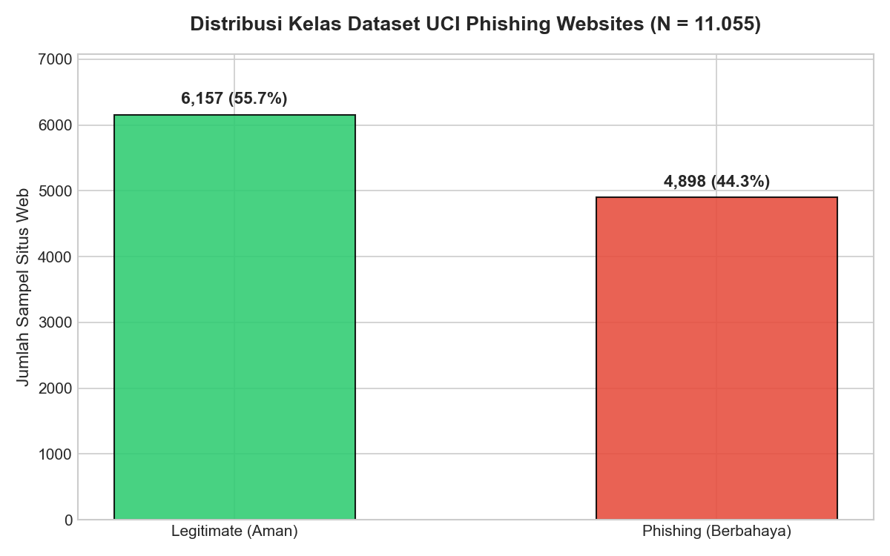
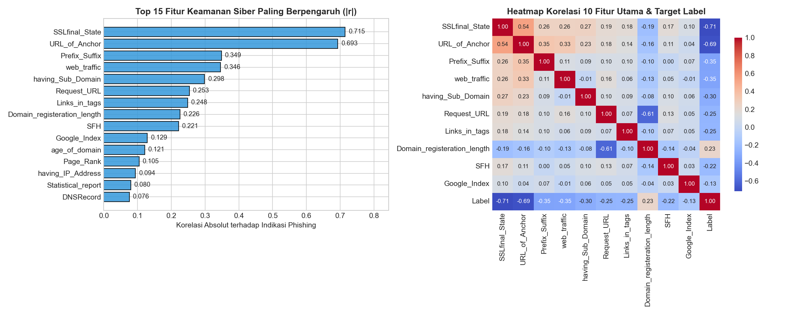
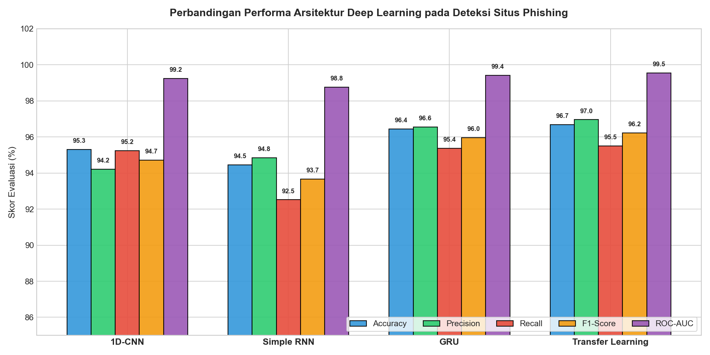
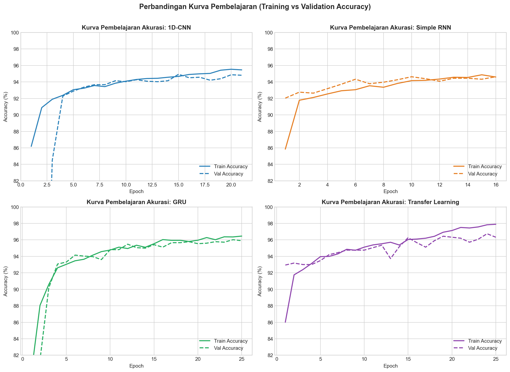
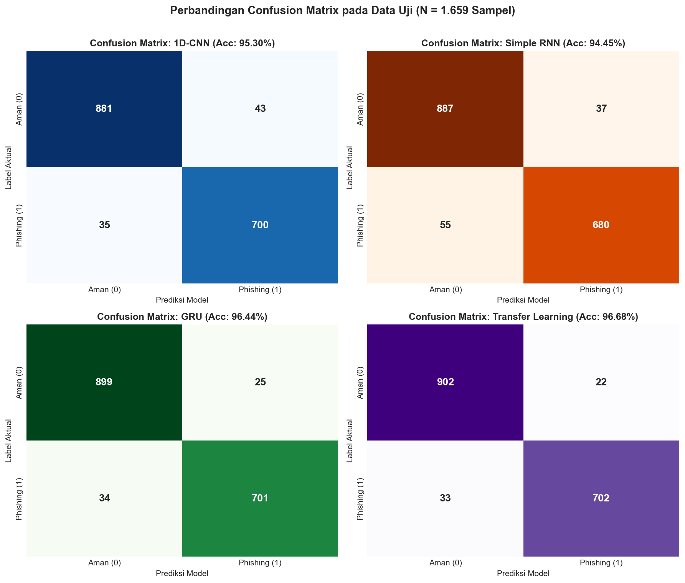
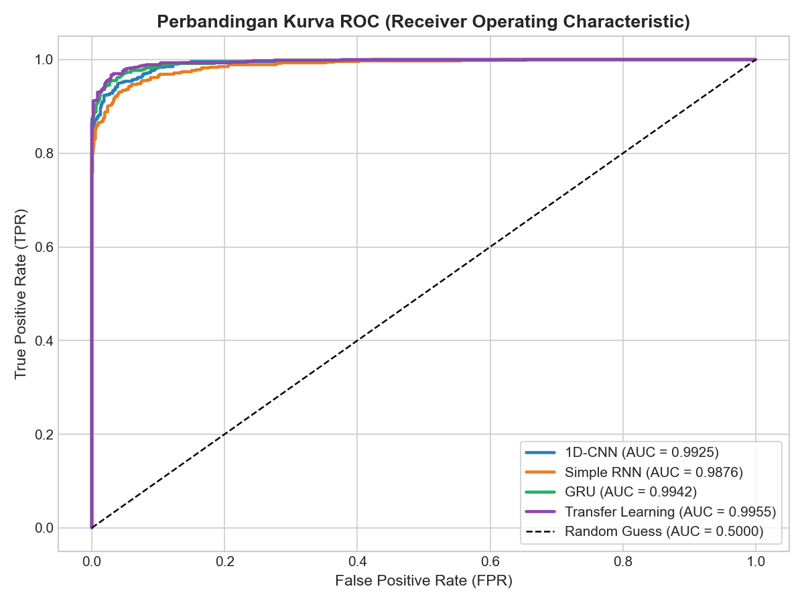

# 🛡️ Deteksi Serangan Situs Web Phishing Menggunakan Deep Learning
### *(Implementasi & Perbandingan Arsitektur: 1D-CNN, Simple RNN, GRU, dan Transfer Learning)*

Proyek ini disusun untuk memenuhi **Tugas Mata Kuliah Deep Learning** dengan mengimplementasikan dan membandingkan beberapa arsitektur Deep Learning (**Convolutional Neural Network / 1D-CNN**, **Recurrent Neural Network / Simple RNN**, **Gated Recurrent Unit / GRU**, serta **Transfer Learning**) pada studi kasus keamanan siber (*Cybersecurity*), yaitu deteksi situs web berbahaya (*Phishing Website Detection*).

---

## 📊 Informasi & Sumber Resmi Dataset (Valid & Terverifikasi)

Dataset yang digunakan dalam penelitian/tugas ini berasal dari repositori akademik resmi **UCI Machine Learning Repository**:

| Informasi | Detail |
| :--- | :--- |
| **Nama Dataset** | **UCI Phishing Websites Dataset** (UCI ID #327 / OpenML ID #4534) |
| **Peneliti / Penyusun** | Rami M. Mohammad, Lee McCluskey, & Fadi Thabtah (*University of Huddersfield, UK*) |
| **DOI Resmi** | [`https://doi.org/10.24432/C51W2X`](https://doi.org/10.24432/C51W2X) |
| **Link Resmi UCI ML Repository** | [`https://archive.ics.uci.edu/dataset/327/phishing+websites`](https://archive.ics.uci.edu/dataset/327/phishing+websites) |
| **Link Mirror Resmi OpenML** | [`https://www.openml.org/d/4534`](https://www.openml.org/d/4534) |
| **File Lokal di Repository** | [`dataset/phishing_websites_uci.csv`](dataset/phishing_websites_uci.csv) |
| **Jumlah Sampel & Fitur** | **11.055 situs web** dengan **30 fitur indikator keamanan siber** + 1 kolom target (`Result`) |
| **Distribusi Kelas Target** | **6.157 Legitimate / Aman (55,7%)** dan **4.898 Phishing / Berbahaya (44,3%)** |

### Daftar 30 Fitur Indikator Keamanan Siber
Dataset ini mengekstraksi 30 karakteristik teknis dari setiap situs web yang terbagi ke dalam 4 kategori:
1. **Address Bar-Based Features (12 Fitur):** `having_IP_Address`, `URL_Length`, `Shortining_Service`, `having_At_Symbol`, `double_slash_redirecting`, `Prefix_Suffix`, `having_Sub_Domain`, `SSLfinal_State`, `Domain_registeration_length`, `Favicon`, `port`, `HTTPS_token`.
2. **Abnormal-Based Features (6 Fitur):** `Request_URL`, `URL_of_Anchor`, `Links_in_tags`, `SFH`, `Submitting_to_email`, `Abnormal_URL`.
3. **HTML & JavaScript-Based Features (5 Fitur):** `Redirect`, `on_mouseover`, `RightClick`, `popUpWidnow`, `Iframe`.
4. **Domain-Based Features (7 Fitur):** `age_of_domain`, `DNSRecord`, `web_traffic`, `Page_Rank`, `Google_Index`, `Links_pointing_to_page`, `Statistical_report`.

---

## 🔍 Exploratory Data Analysis (EDA)

### 1. Distribusi Kelas Target


### 2. Korelasi Fitur Keamanan Siber Terhadap Serangan Phishing
Fitur `SSLfinal_State` (status sertifikat SSL/HTTPS), `URL_of_Anchor` (tautan jangkar halaman), `Prefix_Suffix` (tanda hubung `-` pada domain), `web_traffic`, dan `having_Sub_Domain` memiliki korelasi tertinggi terhadap indikasi situs web *phishing*.



---

## 🧠 Arsitektur Deep Learning yang Diimplementasikan

Untuk memenuhi ketentuan tugas secara menyeluruh, proyek ini mengimplementasikan **4 arsitektur Deep Learning**:

1. **1D-CNN (*1D Convolutional Neural Network*)**
   - Menggunakan tiga blok konvolusi 1 dimensi (`Conv1D` dengan 64 → 128 → 64 filter, `kernel_size=3`), `BatchNormalization`, `MaxPooling1D`, `Dropout(0.25)`, dan `GlobalAveragePooling1D` sebelum masuk ke *fully connected layer* (`Dense`).
   - Efektif menangkap pola kombinasi lokal antar indikator keamanan siber yang berdekatan.

2. **Simple RNN (*Recurrent Neural Network*)**
   - Mengelompokkan 30 fitur menjadi 6 langkah sekuensial (*timesteps*) berdimensi 5 fitur, kemudian diproses menggunakan dua layer `SimpleRNN` (64 dan 32 unit) dengan aktivasi `tanh`, `BatchNormalization`, dan `Dropout`.

3. **GRU (*Gated Recurrent Unit*)**
   - Menggunakan arsitektur **Bidirectional GRU** (64 unit) diikuti layer **GRU** (32 unit).
   - Mekanisme *Update Gate* dan *Reset Gate* pada GRU mampu mempertahankan informasi antar kelompok fitur dari awal hingga akhir tanpa mengalami masalah *vanishing gradient* seperti pada Simple RNN.

4. **Transfer Learning (*Pre-trained 1D-CNN Feature Backbone + Fine-Tuning*)**
   - **Tahap 1 (*Pre-training*):** Melatih *Convolutional Feature Extractor* (1D-Autoencoder Backbone) untuk mempelajari representasi laten dari struktur 30 fitur keamanan siber.
   - **Tahap 2 (*Weight Transfer & Fine-Tuning*):** Memindahkan bobot *encoder* yang telah dilatih (*pre-trained weights*), menambahkan *classification head* (`GlobalMaxPooling1D` → `Dense(128)` → `Dropout(0.25)` → `Dense(64)` → `Sigmoid`), dan melakukan *fine-tuning* dengan *learning rate* rendah (`8e-4`).

---

## 📈 Hasil Evaluasi & Perbandingan Performa Model

Seluruh model dievaluasi pada **Data Uji (Test Set = 1.659 sampel)** yang tidak pernah dilihat selama proses pelatihan:

| Arsitektur Model | Accuracy (%) | Precision (%) | Recall (%) | F1-Score (%) | ROC-AUC (%) | Waktu Training (detik) | Jumlah Parameter |
| :--- | :---: | :---: | :---: | :---: | :---: | :---: | :---: |
| **Transfer Learning** 🏆 | **96.68%** | **96.96%** | **95.51%** | **96.23%** | **99.55%** | 59.70 s | 67.009 |
| **GRU (Bidirectional)** 🥈 | **96.44%** | **96.56%** | **95.37%** | **95.96%** | **99.42%** | 38.60 s | 44.545 |
| **1D-CNN** 🥉 | **95.30%** | **94.21%** | **95.24%** | **94.72%** | **99.25%** | 36.62 s | 54.593 |
| **Simple RNN** | **94.45%** | **94.84%** | **92.52%** | **93.66%** | **98.76%** | **15.16 s** | **9.057** |

### Visualisasi Perbandingan Metrik Evaluasi


### Kurva Pembelajaran (*Training vs Validation Accuracy*)


### Confusion Matrix pada Data Uji (Test Set)


### Perbandingan Kurva ROC-AUC


---

## 📁 Struktur Direktori Repository

```text
├── dataset/
│   └── phishing_websites_uci.csv          # Dataset resmi UCI Phishing Websites (11.055 sampel)
├── images/
│   ├── 01_class_distribution.png          # Grafik distribusi kelas Aman vs Phishing
│   ├── 02_feature_correlation.png         # Grafik korelasi fitur keamanan siber & Heatmap
│   ├── 03_training_history.png            # Kurva akurasi Training vs Validation
│   ├── 04_confusion_matrices.png          # Confusion Matrix keempat model
│   ├── 05_model_comparison.png            # Bar chart perbandingan metrik evaluasi
│   └── 06_roc_curves.png                  # Kurva ROC-AUC gabungan
├── models/
│   ├── 1d_cnn_model.keras                 # Model 1D-CNN tersimpan
│   ├── simple_rnn_model.keras             # Model Simple RNN tersimpan
│   ├── gru_model.keras                    # Model GRU tersimpan
│   └── transfer_learning_model.keras      # Model Transfer Learning tersimpan
├── results/
│   ├── metrics_summary.csv                # Tabel hasil evaluasi dalam format CSV
│   └── metrics_summary.json               # Hasil evaluasi dalam format JSON
├── Phishing_Detection_Deep_Learning.ipynb # Jupyter Notebook lengkap dengan visualisasi
├── train_and_evaluate.py                  # Script utama pelatihan & evaluasi model
├── requirements.txt                       # Daftar dependensi library Python
└── README.md                              # Dokumentasi proyek
```

---

## 🚀 Cara Menjalankan Proyek

1. **Instalasi Dependensi:**
   ```bash
   pip install -r requirements.txt
   ```
2. **Menjalankan Pelatihan & Evaluasi Lewat Script Python:**
   ```bash
   python train_and_evaluate.py
   ```
3. **Membuka lewat Jupyter Notebook:**
   Buka file [`Phishing_Detection_Deep_Learning.ipynb`](Phishing_Detection_Deep_Learning.ipynb) menggunakan Jupyter Notebook, JupyterLab, atau VS Code.

---

## 📚 Referensi Sitasi Akademik Dataset
> Mohammad, R., McCluskey, L., & Thabtah, F. (2012). *Phishing Websites* [Dataset]. UCI Machine Learning Repository. https://doi.org/10.24432/C51W2X
