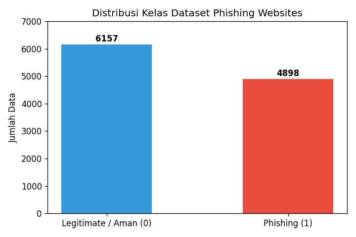
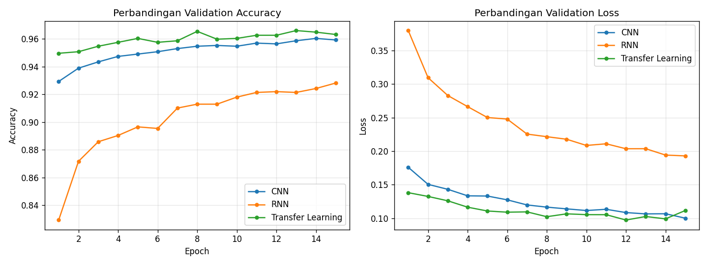
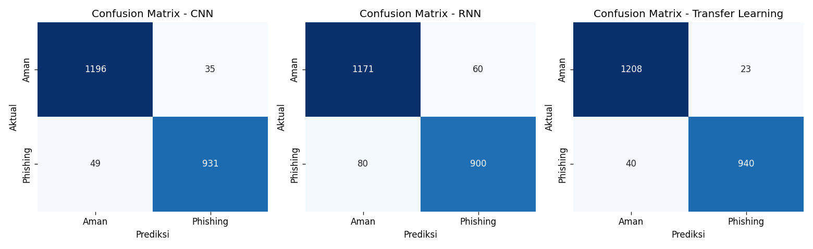
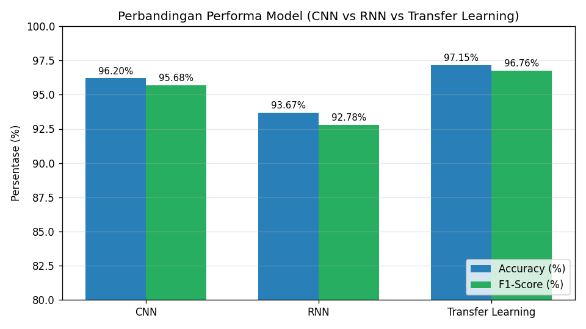

# Tugas Deep Learning: Deteksi Website Phishing
**Implementasi Model: CNN, RNN, dan Transfer Learning**

Repository ini berisi tugas individu mata kuliah **Deep Learning** untuk mendeteksi situs web *phishing* menggunakan 3 arsitektur:
1. **CNN (*Convolutional Neural Network*)**
2. **RNN (*Recurrent Neural Network*)**
3. **Transfer Learning**

---

## 📊 Dataset yang Digunakan
- **Nama Dataset:** UCI Phishing Websites Dataset
- **Sumber Resmi Dataset:** [https://archive.ics.uci.edu/dataset/327/phishing+websites](https://archive.ics.uci.edu/dataset/327/phishing+websites) (DOI: `10.24432/C51W2X`)
- **File Dataset:** [`dataset/phishing_websites_uci.csv`](dataset/phishing_websites_uci.csv)
- **Deskripsi:** Berisi **11.055 data website** dengan **30 fitur karakteristik website** (seperti panjang URL, penggunaan HTTPS/SSL, umur domain, redirect, dll.) dan 1 kolom target (`0` = Website Aman / Legitimate, `1` = Website Phishing).



---

## ⚙️ Arsitektur Model
1. **CNN:** Menggunakan layer `Conv1D` (32 dan 64 filter), `MaxPooling1D`, `Flatten`, `Dense(64)`, `Dropout(0.3)`, dan output `Sigmoid`.
2. **RNN:** Menggunakan layer `SimpleRNN(32)`, `Dense(32)`, `Dropout(0.3)`, dan output `Sigmoid`.
3. **Transfer Learning:** Menggunakan bagian ekstraksi fitur (*feature extractor*) dari model CNN yang telah dilatih (`trainable = False`), lalu ditambahkan layer klasifikasi baru (`Dense(128)` → `Dropout(0.3)` → `Dense(64)` → `Sigmoid`).

---

## 📈 Hasil Evaluasi Model (Data Test = 20%)

| Model | Accuracy (%) | Precision (%) | Recall (%) | F1-Score (%) |
| :--- | :---: | :---: | :---: | :---: |
| **CNN** | 96.20% | 96.38% | 95.00% | 95.68% |
| **RNN** | 93.67% | 93.75% | 91.84% | 92.78% |
| **Transfer Learning** | **97.15%** | **97.61%** | **95.92%** | **96.76%** |

### Grafik Akurasi & Loss


### Confusion Matrix


### Perbandingan Performa


---

## 🚀 Cara Menjalankan
1. Install library yang dibutuhkan:
   ```bash
   pip install -r requirements.txt
   ```
2. Jalankan script Python atau buka file Notebook:
   ```bash
   python train_and_evaluate.py
   ```
   atau buka [`Phishing_Detection_Deep_Learning.ipynb`](Phishing_Detection_Deep_Learning.ipynb) di Jupyter Notebook / Google Colab / VS Code.
